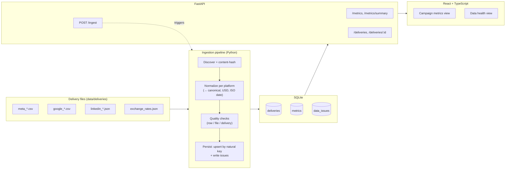
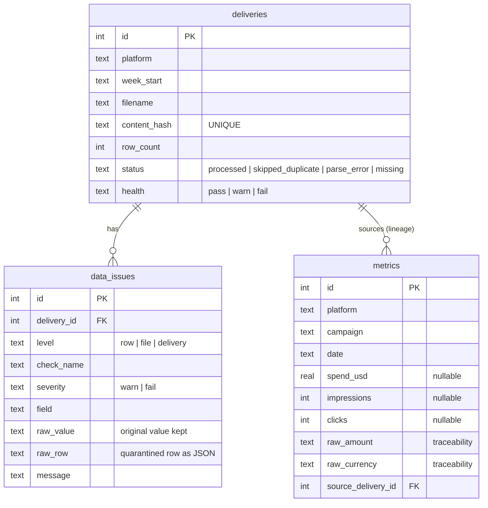

# Architecture

How the pieces fit together, end to end.

> The diagrams below are [Mermaid](https://mermaid.js.org/) — GitHub renders them
> automatically. If you're reading in a plain editor, the ASCII overview is at the bottom.

---

## 1. System overview



**Flow in one line:** files → normalize + quality-check → SQLite → API → UI.
The UI's *Re-ingest* button calls `POST /ingest`, which re-runs the pipeline.

---

## 2. Components

| Layer | Where | Responsibility |
|---|---|---|
| **Discovery** | `app/ingest/discover.py` | Find delivery files, parse `platform` + `week_start` from the filename, compute a content hash. |
| **Normalizers** | `app/ingest/normalizers/` | One per platform. Turn a raw row into a canonical row (USD, ISO date) and report issues. |
| **Pipeline** | `app/ingest/pipeline.py` | Orchestrates: dedupe → parse → normalize → persist → cross-delivery checks. |
| **Storage** | `app/schema.sql`, `app/db.py` | SQLite: `deliveries`, `metrics`, `data_issues`. |
| **API** | `app/api/` | Read endpoints (metrics, deliveries) + `POST /ingest`. |
| **Frontend** | `frontend/src/` | Two views over the API: metrics table and health dashboard. |

---

## 3. Data model



**Key design points**

- `metrics` has `UNIQUE(platform, campaign, date)` — the **natural key**. Upserting on it
  means re-running the pipeline converges to the same rows (idempotency). `delivery_id`
  is deliberately *not* part of the key; it is kept as `source_delivery_id` for lineage.
- `deliveries.content_hash` is `UNIQUE` — identical bytes are skipped automatically,
  which is how the duplicate `_resend` file is caught.
- Numbers are **only transformed when reversible**. Lossy conversions (EUR→USD) are
  allowed only because `raw_amount` + `raw_currency` are stored. If a value can't be
  trusted it is set to `null` and the original is recorded in `data_issues`.
  If a *key* field (date/campaign) can't be trusted, the whole row is quarantined.

---

## 4. ASCII fallback

```
data/deliveries/*             ┌──────────── Ingestion pipeline (Python) ────────────┐
  meta_*.csv     ───────────▶ │ 1. Discover + content-hash (file dedupe)            │
  google_*.csv   ───────────▶ │ 2. Parse (per-platform adapter) → raw rows          │
  linkedin_*.json ──────────▶ │ 3. Normalize (→ canonical: USD, ISO date)           │
  exchange_rates.json ──────▶ │ 4. Quality checks (row / file / delivery) → health  │
                              │ 5. Persist (upsert by natural key; write issues)    │
                              └───────────────┬─────────────────────────────────────┘
                                              ▼
                               SQLite (deliveries, metrics, data_issues)
                                              ▲
                              FastAPI ────────┘   (/metrics, /deliveries, /ingest)
                                              ▲
                              React + TS (metrics view, health view)
```
